<div align="center">


<br /><br />


<br /><br />



</div>

## `> cat about_me.py`

```python
class Dbdlf:
    name = "LIM YUJUNG"
    major = "Artificial Intelligence"
    minor = "Cloud Convergence (Data Security COSS)"
    languages = ["Python", "Java", "C", "C++", "JSX"]
    focus = ["NLP", "Machine Learning", "Cybersecurity", "Cloud"]
    currently_learning = ["AWS", "Linux"]
    next_up = ["Cybersecurity Developer Track @ CNU"]
    motto = "Una."
```

## `> cat roadmap.md`

- 🗣️ **NLP** — making machines understand language
- 🔐 **Cybersecurity** — CNU Information Security Specialized University · Cybersecurity Developer Track (2027 →)
  - Secure Coding · Cloud Security · AI Security · Modern Cryptography
- ☁️ **Cloud** — Cloud Convergence minor · CNU Data Security COSS
  - Cloud Platform Fundamentals · Cloud Utilization · Cloud Application SW Development
  - Cloud Database · Cloud Architecture · Cloud Service Design

## `> ls ./languages`

<p align="center">
  
</p>

## `> ls ./ai_and_data`

<p align="center">
  
  <br />
  
  
  
  
</p>

## `> ls ./frameworks`

<p align="center">
  
</p>

## `> ls ./cloud_and_tools`

<p align="center">
  
  <br />
  
  
</p>

---

<div align="center">


</div>
